<picture>
  <source media="(prefers-color-scheme: dark)" srcset="https://raw.githubusercontent.com/favodev/favodev/main/assets/keynote-dark.svg">
  <source media="(prefers-color-scheme: light)" srcset="https://raw.githubusercontent.com/favodev/favodev/main/assets/keynote-light.svg">
  
</picture>

  <a href="https://github.com/sponsors/favodev">
    <picture>
      <source media="(prefers-color-scheme: dark)" srcset="https://raw.githubusercontent.com/favodev/favodev/main/assets/sponsor-dark.svg">
      <source media="(prefers-color-scheme: light)" srcset="https://raw.githubusercontent.com/favodev/favodev/main/assets/sponsor-light.svg">
      
    </picture>
  </a>

